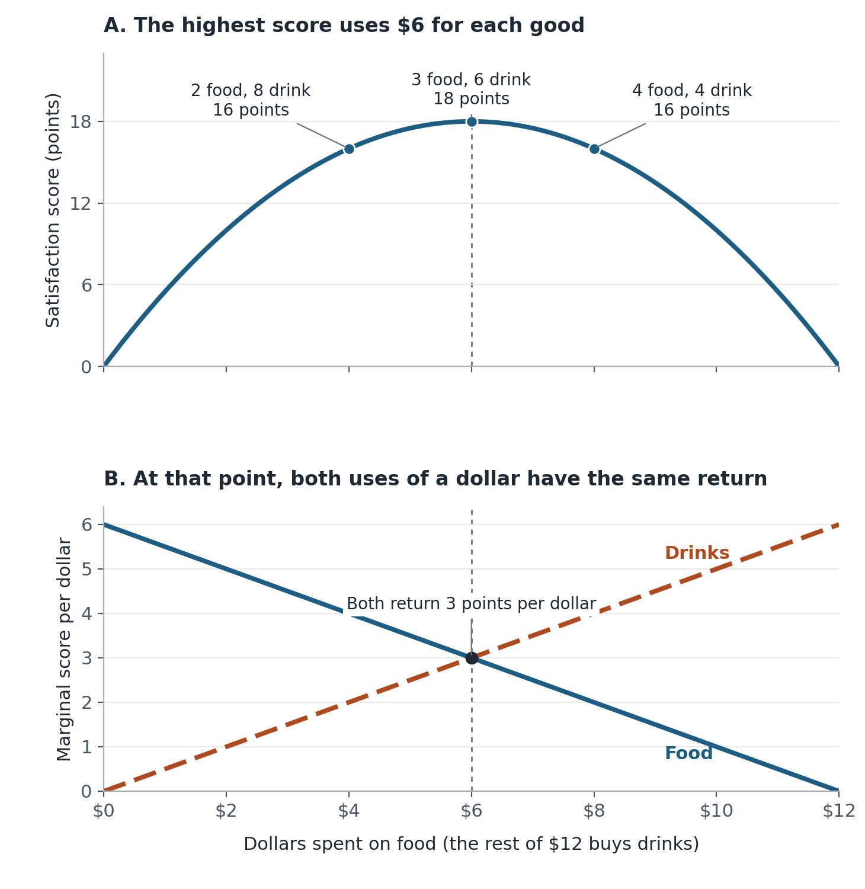

You have spent your lunch budget well, yet another bite and another drink would both be welcome. If calculus says a maximum has a zero derivative, how can this be your best choice?

This puzzle matters whenever we divide a limited budget: **when should we stop moving money between things we still enjoy?** Lagrange multipliers answer that question. Their unfamiliar extra symbol, $\lambda$, becomes much less mysterious once we understand the trade-off it records.

## A lunch budget, with deliberately simple preferences

Suppose you have \$12. Food costs \$2 per portion and drinks cost \$1 per portion. Let $x$ and $y$ be the quantities, allowing divisible portions to keep the arithmetic simple. Give each combination the illustrative satisfaction score

$$
U(x,y)=xy.
$$

Multiplication captures a preference for a mix: extra food is more enjoyable when there is something to drink with it, and vice versa. These prices and preferences are invented assumptions, not survey data.

With both quantities positive, more of either raises the score. The best choice therefore spends the full budget: $2x+y=12$.

Start with 2 food portions and 8 drink portions. The score is 16. Move \$2 from drinks to food: now you have 3 food portions and 6 drink portions, scoring 18. Move another \$2 the same way and the score falls back to 16. The first switch improved the mix; the second removed drinks that had become more valuable alongside the additional food.

## Compare what the same dollar buys

A small increase in food raises the score at a rate of $y$ points per portion. Because a food portion costs \$2, the marginal gain per dollar is $y/2$. For drinks, it is $x/1$.

At the starting allocation, these returns are 4 and 2 points per dollar. Moving a little spending toward food helps because its gain exceeds the loss from buying fewer drinks.

As food spending rises, fewer drinks remain, reducing food's marginal return. More food also makes drinks more valuable. The two returns meet at 3 food portions and 6 drink portions:

$$
\frac{6}{2}=\frac{3}{1}=3.
$$

{#fig-budget width=100% fig-alt="Top: satisfaction peaks at six dollars spent on food. Bottom: the marginal satisfaction per dollar from food falls and that from drinks rises; both equal three at the same allocation."}

@fig-budget connects the highest score to equal marginal gains **per dollar**. Equal quantities or equal gains per portion would miss the different prices. Here the curve confirms a maximum; in other problems, first-order conditions alone may identify other kinds of stationary points.

Both goods still offer positive benefits at this allocation. The usual zero-derivative rule must be applied to changes the budget allows. An increase in one quantity requires sacrificing the other. For a tiny budget-neutral transfer, the immediate gain and loss cancel. Larger transfers move us away from the best mix: shifting \$2 either way lowers the score from 18 to 16.

## The extra symbol has an economic meaning

The Lagrangian collects that spending rule and the budget in one expression:

$$
\mathcal L=xy+\lambda(12-2x-y).
$$

Setting its derivatives to zero gives $y=2\lambda$, $x=\lambda$, and $2x+y=12$. Thus $y/2=x=\lambda$: the multiplier names the common marginal gain per dollar. Solving gives $x=3$, $y=6$, and $\lambda=3$. The derivatives of satisfaction itself remain positive; the equations subtract the opportunity cost of spending the budget.

The same number also explains why more money still helps. With a general budget $I$, the best quantities are $x=I/4$ and $y=I/2$, giving $V(I)=I^2/8$. At $I=12$, $V'(I)=3$: a small budget increase raises the best attainable score by approximately 3 points per dollar.

For example, a \$13 budget raises the maximum from 18 to 21.125, a gain of 3.125. That is close to 3, rather than exactly 3, because the multiplier is a local rate. Its units depend on our chosen satisfaction scale; it is not a dollar measure of happiness.

For a smooth optimum with both goods purchased, the practical question is whether a small spending transfer could improve the outcome. Here equal marginal gains per dollar mark the best affordable mix, while a positive $\lambda$ measures the benefit of relaxing the budget. **You can have allocated your money well and still value having more.**

---

**Sources and replication.** This is an analytical teaching example; no external dataset is used. The standard mathematical method is described in [OpenStax, *Calculus Volume 3*, §4.8](https://openstax.org/books/calculus-volume-3/pages/4-8-lagrange-multipliers). The [replication guide](README.md), [Python code](code/build.py), and [model assumptions](data/model.json) reproduce the numerical results and figure.
