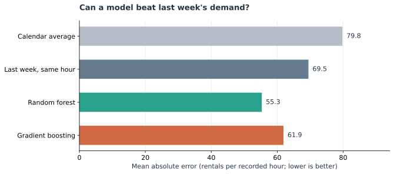
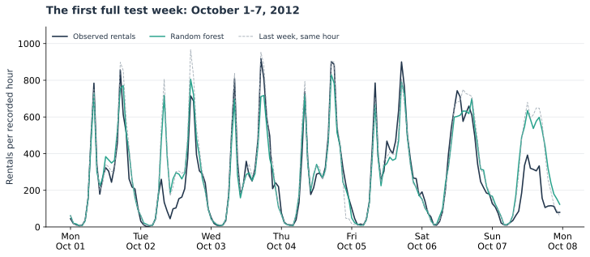
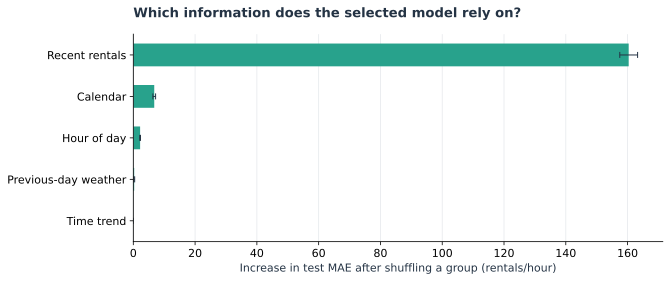

A bike-share operator planning tomorrow's service needs to anticipate busy hours. Last week's demand provides an inexpensive starting point: predict the same number of rentals as the corresponding hour seven days ago. Can machine learning improve enough on that rule to justify a more complicated forecast?

I tested a random forest and gradient boosting on Washington-area Capital Bikeshare records. **Random forest reduced average error by 20% relative to the weekly rule.** The useful comparison is with that repeating weekly pattern, rather than simply showing that a model fits historical demand.

## Predicting tomorrow with information available today

The [UCI Bike Sharing dataset](https://archive.ics.uci.edu/dataset/275/bike+sharing+dataset) contains 17,379 recorded hours during 2011–2012, with daily totals, weather, and calendar information. I predict system-wide completed rentals in each recorded hour, not unmet demand or the number of bicycles needed at individual stations.

At the end of each day, the model predicts all of tomorrow's hours. Inputs include the calendar, rental counts from the same hour yesterday and last week, recent demand averages, and yesterday's weather. Tomorrow's observed weather is excluded because it would be unknown when forecasting. I also exclude `casual` and `registered`: their sum is the target, so including them would reveal the answer.

The calendar grid has 165 unrecorded hours. I leave these missing and calculate lags by timestamp, rather than shifting rows. Requiring observed yesterday/week-ago counts and sufficient history excludes 431 records, leaving 16,948 observations. Results therefore describe recorded hours with usable history; missing periods are not treated as zero demand.

## A comparison without looking ahead

The last three months, October–December 2012, form a reserved test set of **2,101 hours**. Earlier observations supply training and three expanding validation rounds: predict January–March, April–June, and July–September 2012 using only preceding dates.

A random forest averages many decision trees; gradient boosting builds trees sequentially to improve earlier predictions. I compare eight forest settings and twelve boosting settings, varying tree size, learning rate, and regularization as appropriate. Preprocessing is fitted separately within each training window. I choose settings and the final model using pooled validation mean absolute error (MAE), before evaluating any test predictions.

Two benchmarks keep the comparison honest: a training-period average for each hour/workday combination, and last week's corresponding hour. All four use identical test observations. Models stay fixed throughout testing, while historical inputs update daily as new observations become available.

```{=html}
<figure>
<picture><source media="(max-width:540px)" srcset="figures/model_comparison_mobile.png"></picture>
<figcaption>Figure 1. October–December 2012. Errors are rentals per recorded hour; the model choice was fixed using earlier validation data.</figcaption>
</figure>
```

| Model | Validation MAE | Test MAE | Test RMSE |
|:--|--:|--:|--:|
| Calendar average | 100.5 | 79.8 | 119.4 |
| Last week, same hour | 57.5 | 69.5 | 114.8 |
| Random forest | 56.6 | 55.3 | 89.2 |
| Gradient boosting | 61.6 | 61.9 | 94.8 |

The selected model misses by **55.3 rentals per hour on average**, compared with 69.5 for the weekly rule. Its RMSE is 89.2; RMSE gives extra weight to large mistakes. On working days at 7–9 a.m. and 4–7 p.m., its MAE is 86.1 versus 117.0 for the weekly rule. This checks performance during potentially demanding service periods instead of relying only on quiet hours.

```{=html}
<figure>
<picture><source media="(max-width:540px)" srcset="figures/first_test_week_mobile.png"></picture>
<figcaption>Figure 2. The first full test week, fixed in advance as the example window. The overall scores include the entire test quarter.</figcaption>
</figure>
```

The forecasts reproduce repeated peaks but overpredict Sunday's demand: the selected model averages 292 rentals per hour on October 7, compared with 146 observed. Learning the weekly pattern does not eliminate substantial errors on individual days.

## What did the model learn?

I shuffle related predictors together and measure how much the selected model's test MAE increases. Grouping the rental-history variables avoids treating several correlated demand measures as independent sources of information. The model relies most on **recent rentals**: shuffling that group increases MAE by 160.4 rentals per hour.

```{=html}
<figure>
<picture><source media="(max-width:540px)" srcset="figures/feature_importance_mobile.png"></picture>
<figcaption>Figure 3. Grouped permutation importance for Random forest. Whiskers show one standard deviation across 20 shuffles, not confidence intervals.</figcaption>
</figure>
```

These are measures of the fitted model's reliance, not causal effects. Shuffling can create unusual combinations, and low importance does not establish that weather or another factor is irrelevant.

I would choose **Random forest**, following its earlier validation performance, while retaining the weekly rule as an operational reference. Its validation advantage was small, so one favorable test quarter cannot establish lasting superiority. Nor does this establish current accuracy: the sample covers one system more than a decade ago and measures completed rentals. Before deployment, I would validate on recent records and check station-level service outcomes. The practical lesson is to earn a complicated model's place by beating a credible simple forecast on later data.

::: {.callout-note collapse="true" title="Data, code, and replication"}

[Replication instructions](README.txt) · [Complete Python analysis](code/build_blog.py) · [Original hourly data](data/raw/hour.csv) · [Daily data](data/raw/day.csv) · [Scores](results/performance.csv) · [All test predictions](results/test_predictions.csv) · [Validation settings](results/model_selection.json) · [GitHub folder](https://github.com/ElaineYnH/Yining-Han-Website/tree/main/blog/posts/post10)

Data: Hadi Fanaee-T, *Bike Sharing*, UCI Machine Learning Repository, [doi:10.24432/C5W894](https://doi.org/10.24432/C5W894), CC BY 4.0. Original study: Fanaee-T and Gama, [*Event labeling combining ensemble detectors and background knowledge*](https://doi.org/10.1007/s13748-013-0040-3). The unmodified source files and dataset README are included. Methods: scikit-learn's [random forest](https://scikit-learn.org/stable/modules/generated/sklearn.ensemble.RandomForestRegressor.html), [histogram gradient boosting](https://scikit-learn.org/stable/modules/generated/sklearn.ensemble.HistGradientBoostingRegressor.html), and [permutation importance](https://scikit-learn.org/stable/modules/permutation_importance.html).

:::
