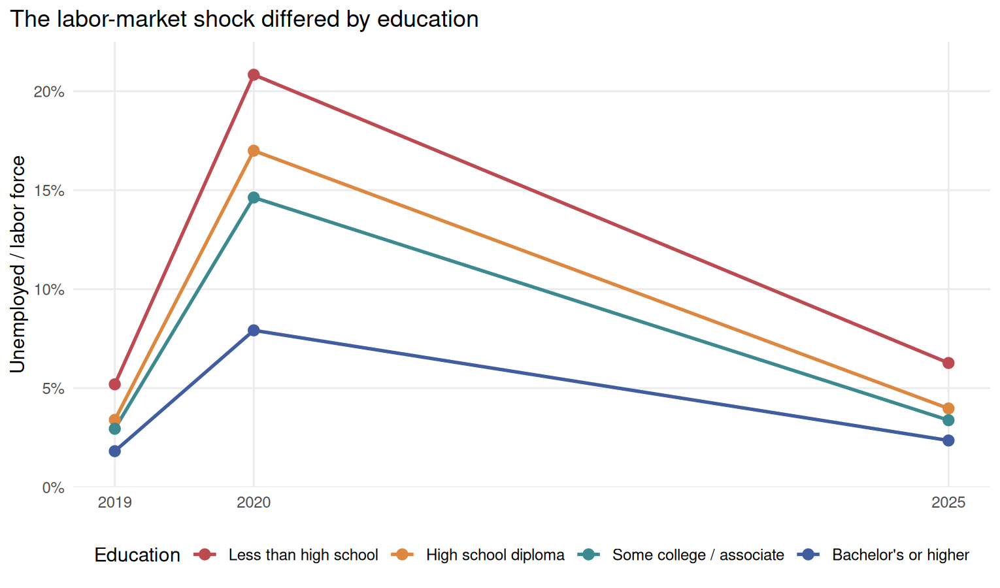
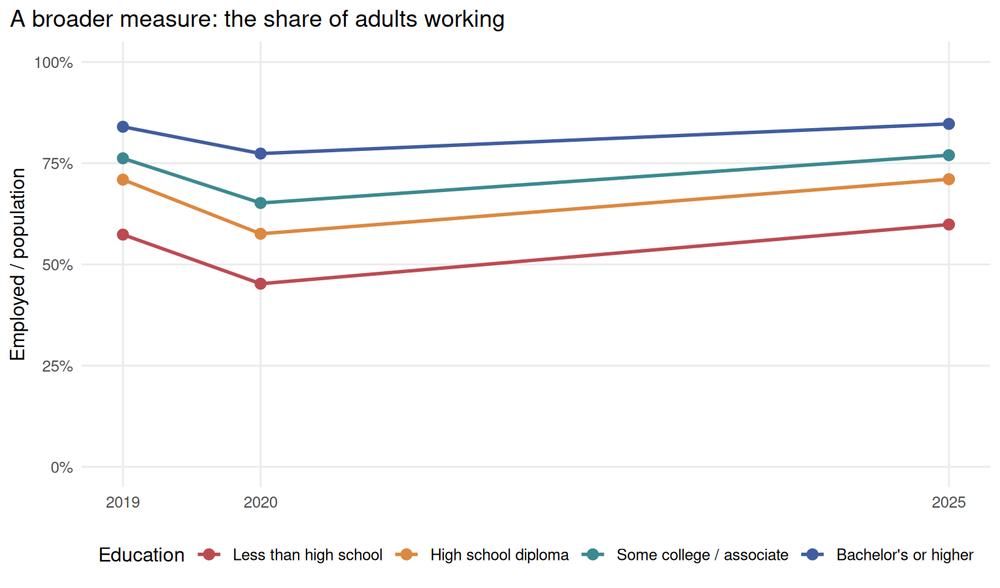
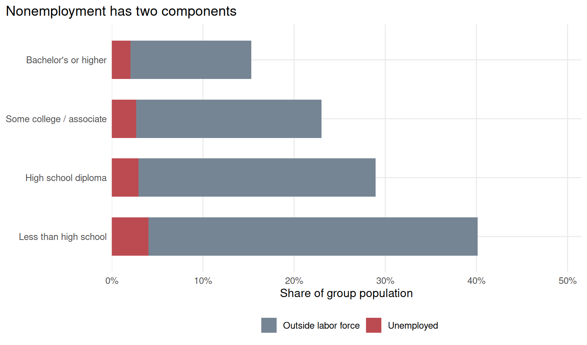

By April 2025, unemployment had fallen sharply from its pandemic level across education groups. That sounds like a broad recovery. **Had the education gap in having a job also closed?** Three views of the same CPS sample show why these are different questions: unemployment measures conditions within the labor force, while jobholding also depends on whether adults participate in it.

I compare adults ages **25–64** in **April 2019, April 2020, and April 2025**, using [IPUMS CPS](https://doi.org/10.18128/D030.V13.0). Every numerator and denominator uses the basic monthly person weight [WTFINL](https://cps.ipums.org/cps-action/variables/WTFINL). These are population estimates for four education groups, not percentages of the downloaded rows. Holding the month fixed improves comparability; the lines connect three snapshots rather than a complete monthly series.

## 1. The unemployment shock eased

{#fig-unemployment width=100% fig-alt="Unemployment rises for all four education groups in April 2020, then falls by April 2025. The rise is largest for adults without a high-school diploma."}

For adults without a high-school diploma, unemployment rose from **5.2%** to **20.8%** in 2019–20. For bachelor's-degree holders and above, it rose from **1.8%** to **7.9%**. The shock was much larger for the least-educated group, but by 2025 the rates had fallen to **6.3%** and **2.4%**, respectively. Both remained above their 2019 levels.

That establishes a rebound among labor-force participants. It leaves a second question: how many adults in each group actually held jobs?

## 2. Jobholding rebounded without closing the gap

{#fig-employment width=100% fig-alt="Employment falls in April 2020 and rebounds by April 2025, while large differences between education groups remain."}

The employment-to-population ratio answers that broader question. By 2025, **84.7%** of the bachelor's-plus group had jobs, compared with **59.9%** of adults without a diploma: a **24.8-percentage-point gap**, or roughly 25 more people working per 100 adults when comparing the two groups.

The gap already measured **26.6 points in 2019**. Each group's 2025 employment point estimate reaches or exceeds its own 2019 level. The snapshots therefore show a rebound toward the groups' earlier positions alongside a large continuing difference between them. The full gap cannot be attributed to the pandemic.

## 3. Most of the 2025 gap sits outside the labor force

{#fig-nonemployment width=100% fig-alt="For every education group, the outside-labor-force segment is much larger than the unemployed segment. The largest total nonemployment share is among adults without a high-school diploma."}

Among adults without a diploma, **36.1%** were outside the labor force and **4.0%** were unemployed. The corresponding shares for bachelor's-plus adults were **13.2%** and **2.0%**. Equivalently, labor-force participation was **63.9%** versus **86.8%**. Using this common denominator, the 24.8-point jobholding gap splits into approximately **22.9 points outside the labor force** and **2.0 points unemployed**. About **92%** of the gap thus corresponds to the difference in nonparticipation. This is an accounting decomposition, not a causal explanation.

Why is the outside-labor-force segment so large? Unemployment is a narrow status: it generally requires active search and availability, with an exception for temporary layoffs. The broader nonparticipating group can include people occupied with schooling, family responsibilities, or retirement, as the [BLS explains](https://www.bls.gov/cps/cps_htgm.htm#nilf). They should not all be interpreted as unsuccessful jobseekers. Our grouped totals do not distinguish these reasons, so they cannot establish which circumstances drive the education difference.

The economic story is therefore a rebound in unemployment alongside a persistent difference in participation and jobholding. Reading the unemployment rate alone would miss most of this population-level employment gap. Assessing the recovery requires looking at who is working and participating, as well as who is looking for work.

These descriptive snapshots do not identify the effect of schooling or track the same individuals. They are not seasonally adjusted headline estimates. [Pandemic misclassification](https://www.bls.gov/blog/2020/update-on-the-misclassification-that-affected-the-unemployment-rate.htm) also complicates the 2020 comparison. **Lower unemployment and broad recovery can coexist with a large education gap in employment.**

---

**Data and replication:** The original [weighted summary](data/cps_education_summary.csv) and [microdata preparation script](prepare_cps.R) are retained. The [build script](code/build_from_summary.R) reproduces the three plots and the [2025 decomposition](results/decomposition_2025.csv). See the [README](README.md) for access and replication steps and the [GitHub source folder](https://github.com/ElaineYnH/Yining-Han-Website/tree/main/blog/posts/post3) for the complete materials. Individual IPUMS records are not republished.
