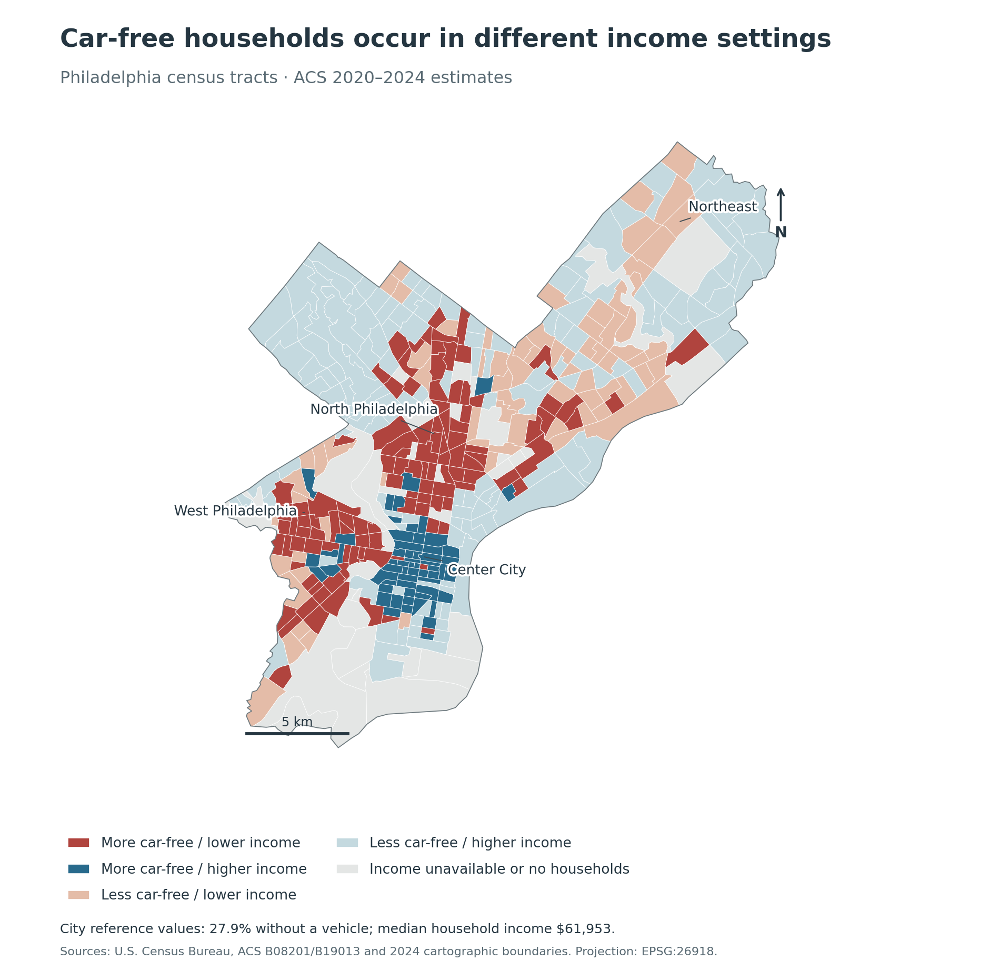
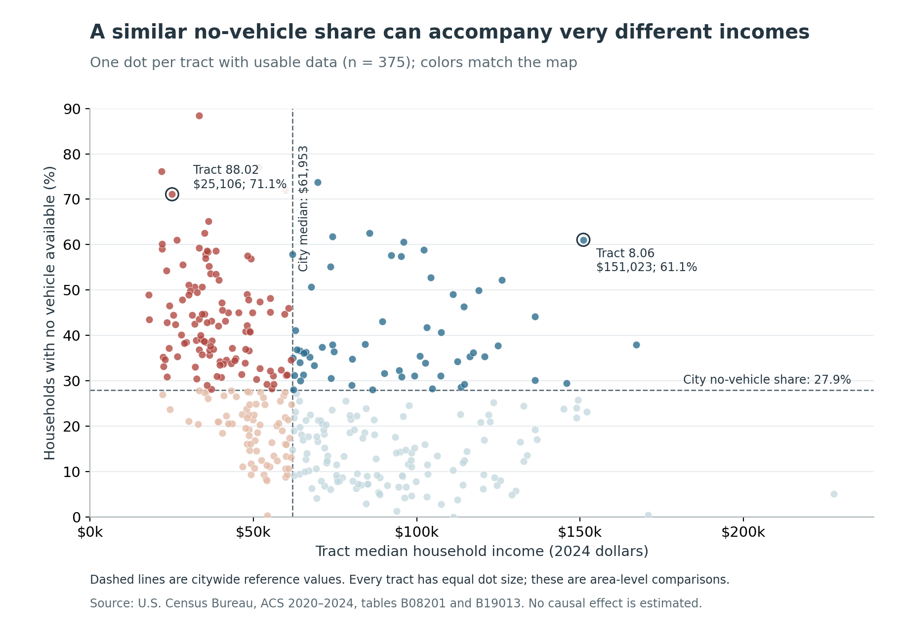

Living without a car can mean different things in a city. It may fit a household's location and preferences, or accompany a tight budget and limited transport options. **Where do high shares of households without vehicles overlap with lower incomes in Philadelphia?** This matters for deciding where to investigate transport affordability and service needs. A map of vehicle availability alone cannot distinguish those circumstances.

## Mapping the overlap

I join the Census Bureau's **2020–2024 ACS five-year estimates** to **2024 census-tract boundaries** using the 11-digit tract GEOID. Both cover Philadelphia County, which shares the city's boundaries. The map uses all **408 tracts**. These are small statistical areas, rather than named neighborhoods; five-year estimates describe a period, not a single day in 2024.

The no-vehicle share is households with **no vehicle available divided by all households** in each tract. The citywide estimate is **27.9%** (189,616 of 679,428 households). I compare each tract with that share and the **city median household income of $61,953**, in 2024 dollars. “Lower income” means a tract median below this reference, not an official poverty classification. These benchmarks come from the county estimates, rather than averages of tract percentages or medians.

{#fig-map fig-alt="Map of Philadelphia. High no-vehicle shares and lower incomes overlap in parts of North and West Philadelphia; high no-vehicle shares and higher incomes also occur around Center City."}

*Sources: U.S. Census Bureau, ACS tables B08201 and B19013; 2024 cartographic boundaries. Boundaries are projected to NAD83 / UTM zone 18N (EPSG:26918); the scale bar is in kilometers.*

The red areas show high no-vehicle shares alongside lower incomes, concentrated across parts of North and West Philadelphia. Blue areas around Center City also have above-city no-vehicle shares, but higher tract incomes. Thus, geographically concentrated car-free living has more than one income context. The red areas are sensible places to investigate whether transport costs restrict access to work and services. Their classification does **not** establish that existing transit is inadequate.

## How much of the city does the overlap represent?

| Tract setting | Tracts | No-vehicle households | Share of city's no-vehicle households |
|---|---:|---:|---:|
| More car-free / lower income | 112 | 81,217 | 42.8% |
| More car-free / higher income | 59 | 43,726 | 23.1% |
| Less car-free / lower income | 73 | 25,689 | 13.5% |
| Less car-free / higher income | 131 | 31,371 | 16.5% |
| Income unavailable or no households | 33 | 7,613 | 4.0% |

*Counts are ACS estimates. The final column uses **all city no-vehicle households** as its denominator, including those in unclassified tracts; rounding may affect the sum.*

The **112 red tracts** contain **81,217 households without vehicles**: **42.8%** of the city's total, while accounting for **27.7%** of all households. This gives the spatial overlap practical importance beyond the number or land area of colored polygons. However, **59 higher-income, more-car-free tracts** contain another **43,726 no-vehicle households**. Targeting every car-free area as economically disadvantaged would miss this distinction.

{#fig-scatter fig-alt="Scatterplot of 375 Philadelphia census tracts. High no-vehicle shares occur at low incomes and at incomes above the city median; two labeled examples have incomes of about 25,000 and 151,000 dollars."}

For example, tract **8.06** has a **61.1%** no-vehicle share and median income of **$151,023**. Tract **88.02** has a **71.1%** share with income of **$25,106**. High no-vehicle shares therefore coexist with very different area incomes. Nearby destinations or transit could make car-free living attractive in some places; limited purchasing power could constrain choices elsewhere. Those are possible explanations, not mechanisms identified by this comparison.

## Limits and takeaway

There are **33 unclassified tracts**, including **19 with zero households**. They account for **4.0%** of city no-vehicle households. ACS estimates have sampling error, so tracts near a cutoff may change categories. A check using 30% without a vehicle and income below $60,000 still places **40.3%** of city no-vehicle households in the overlap group; exact boundaries are sensitive to the rule. Tract medians also conceal household differences: this analysis cannot count low-income car-free households or establish why anyone lacks a vehicle. It contains no routes, travel times, or service-quality measures.

**The useful signal is the overlap of car-free living and lower area incomes.** Planners could use the red areas as a starting point for checking fares, service reliability, and access to jobs, then gather route-level and household evidence before choosing interventions. The map identifies where to investigate; it does not by itself establish which transport investment would work.

## Data and replication

Official sources: [ACS five-year data](https://www.census.gov/data/developers/data-sets/acs-5year.html), [B08201: vehicles available](https://api.census.gov/data/2024/acs/acs5/groups/B08201.html), [B19013: median household income](https://api.census.gov/data/2024/acs/acs5/groups/B19013.html), and [Census cartographic boundaries](https://www.census.gov/geographies/mapping-files/time-series/geo/cartographic-boundary.html). The [source record](data/sources.json) documents download URLs and the **2026-10-18** snapshot. [Code and data](https://github.com/ElaineYnH/Yining-Han-Website/tree/main/blog/posts/post5), [replication instructions](README.md), and [tract results](results/tract_results.csv) are available. Running the [Python analysis](code/analyze.py) recreates both figures, tables, and every numerical result in this article from the saved data.
