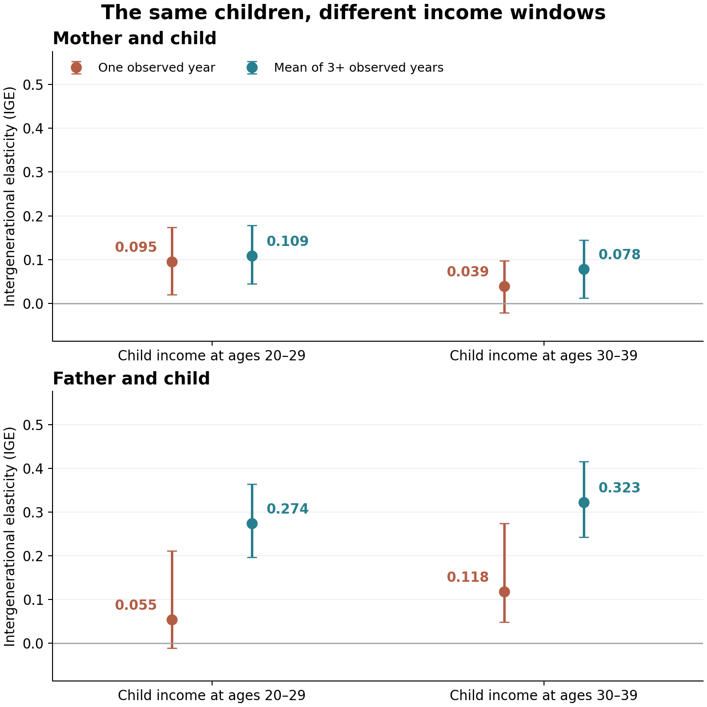

**Would we infer the same link between parents' and children's earnings if we measured the children in their twenties or thirties?** This tutorial matches both mothers and fathers to their children using SQL inside Python, then compares single-year income with averages.

We use real [Panel Study of Income Dynamics (PSID)](https://psidonline.isr.umich.edu/) public-use data: 62,218 individuals and income years 1993–2022. Income is individual labor income, excluding farm and unincorporated business income. Preparation retains released imputations and eligible zero incomes, handles documented special codes, and converts amounts to 2020 dollars with [BLS CPI-U](https://www.bls.gov/cpi/factsheets/purchasing-power-constant-dollars.htm). Ages refer to the income calendar year.

## 1. Open the local database

First follow the [README's replication command](README.md) using your own registered PSID download. It creates `people` and `earnings` tables outside the website repository; individual records are not distributed here. Then run these blocks in order. Python's [sqlite3](https://docs.python.org/3/library/sqlite3.html) needs no separate server.

```python
from pathlib import Path
import sqlite3
import numpy as np
import pandas as pd

WORK = Path.home() / 'blog6_psid_work'
con = sqlite3.connect(WORK / 'psid.sqlite')
```

Income preparation checks each year's sequence number and relationship: a reference person's income belongs to that individual, not automatically to the father. Other household members' earnings are unavailable in this extract.

## 2. Match the recorded parents

```python
links = pd.read_sql_query('''
WITH parent_keys AS (
  SELECT id68 AS child_family, pn AS child_pn,
         mother_id68 AS parent_family, mother_pn AS parent_pn,
         'mother' AS parent_role FROM people
  UNION ALL
  SELECT id68, pn, father_id68, father_pn, 'father' FROM people
)
SELECT k.child_family * 1000 + k.child_pn AS child_id,
       p.id68 * 1000 + p.pn AS parent_id,
       k.child_family AS family_id, k.parent_role
FROM parent_keys AS k
JOIN people AS p ON k.parent_family = p.id68 AND k.parent_pn = p.pn
WHERE k.parent_family > 0 AND k.parent_pn BETWEEN 1 AND 399
ORDER BY child_id, parent_role
''', con)
assert not links.duplicated(['child_id', 'parent_role']).any()
```

`SELECT` chooses columns. `UNION ALL` stacks mother and father links. `JOIN ... ON` matches **both** the parent's original-family identifier and person number, following [PSID's identifier documentation](https://psidonline.isr.umich.edu/Guide/FAQ.aspx). Family ID alone cannot identify a parent. Multiplying it by 1,000 and adding the person number produces a convenient individual ID. A parent can correctly match several children.

## 3. Aggregate before combining generations

```python
def summarize(con, lo, hi, target):
    averages = pd.read_sql_query('''
    SELECT id68 * 1000 + pn AS person_id,
           AVG(income) AS average, COUNT(*) AS n_years
    FROM earnings WHERE age BETWEEN ? AND ?
    GROUP BY id68, pn HAVING COUNT(*) >= 3
    ''', con, params=(lo, hi))
    rows = pd.read_sql_query('''
    SELECT id68 * 1000 + pn AS person_id, year, age, income
    FROM earnings WHERE age BETWEEN ? AND ?
    ''', con, params=(lo, hi))
    rows['distance'] = abs(rows.age - target)
    anchors = (rows.sort_values(['distance', 'year']).drop_duplicates('person_id')
               .rename(columns={'income': 'single'}))
    return averages.merge(anchors[['person_id', 'single']], on='person_id')
```

`WHERE` selects ages; `GROUP BY` gathers observations for each individual. `AVG` calculates their arithmetic mean, including zeros; `COUNT` and `HAVING` require three observed income years. The remaining lines select one year closest to a target age, breaking ties toward the earlier year.

**Try it:** A parent has four income records and their child has three. How many rows would joining annual records by their relationship alone create?

<details>
<summary>Check your answer</summary>

Twelve. Every parent year matches every child year. Aggregate each person's records first to avoid treating these combinations as independent pairs.

</details>

## 4. Hold the children constant

Use parent ages 35–44 and child ages 20–29 and 30–39, with single-year targets 40, 25 and 35. The survey is biennial after 1997: three observed income years need not be consecutive.

```python
sample = links.copy()
specs = [(35, 44, 40, 'p', 'parent_id'),
         (20, 29, 25, 'early', 'child_id'),
         (30, 39, 35, 'later', 'child_id')]
for lo, hi, target, label, key in specs:
    measures = summarize(con, lo, hi, target).rename(columns={
        'person_id': key, 'average': f'{label}_average',
        'single': f'{label}_single', 'n_years': f'{label}_n'})
    sample = sample.merge(measures, on=key, validate='many_to_one')
columns = [f'{g}_{m}' for g in ['p', 'early', 'later']
           for m in ['single', 'average']]
sample = sample.loc[sample[columns].gt(0).all(axis=1)].copy()
both = sample.groupby('child_id').parent_role.nunique().eq(2)
sample = sample.loc[sample.child_id.isin(both[both].index)].copy()
```

Requiring positive log inputs and both parents leaves **606 children**, linked to 424 mothers and 424 fathers. Every specification uses these same children. Both-parent coverage and positive anchor-year earnings select a particular sample; these unweighted estimates are not national mobility statistics.

For each parent separately, estimate the intergenerational elasticity (IGE):

$$
\log Y_c=\alpha+\beta\log Y_p+\varepsilon.
$$

```python
estimates = []
for role in ['mother', 'father']:
    d = sample.loc[sample.parent_role == role]
    for stage in ['early', 'later']:
        for measure in ['single', 'average']:
            x = np.log(d[f'p_{measure}'])
            y = np.log(d[f'{stage}_{measure}'])
            beta, intercept = np.polyfit(x, y, 1)
            estimates.append(dict(parent=role, stage=stage, measure=measure,
                                  ige=beta, n_children=len(d)))
estimates = pd.DataFrame(estimates)
print(estimates.round(3).to_string(index=False))
```

Take logs **after** averaging real dollars. A 1% difference in parental income is associated with approximately a $\beta$% difference in child income. These are separate maternal and paternal associations, not a combined-family-income model or causal effects.

{#fig-income-timing fig-alt="Two panels show maternal and paternal IGE estimates using single-year and averaged income at two child age windows, with 95 percent intervals."}

*Source: PSID public-use data; author's calculations. Parent ages: 35–44. Intervals: 95%, from 2,000 bootstrap draws of 362 kinship groups, keeping shared parents and original family lineages together.*

For fathers, single-year slopes are **0.055** and **0.118**; averaged slopes are **0.274** and **0.323**. A single year's earnings would suggest substantially weaker persistence here. Maternal averaged slopes instead fall from 0.109 to 0.078. Older measurement does not mechanically increase an estimate. The paternal averaged age difference is +0.049, with a paired 95% interval [-0.021, 0.116]: this sample cannot precisely distinguish that difference from zero.

## Why does measurement age matter?

[Haider and Solon (2006)](https://www.aeaweb.org/articles?id=10.1257/aer.96.4.1308) document age-dependent relationships between current and lifetime earnings. Suppose

$$
\log Y_{c,t}=a_t+\lambda_t\log Y_{c,\mathrm{life}}+u_t.
$$

With uncorrelated errors and correctly measured parental lifetime income, the age-$t$ slope is $\lambda_t\beta$. When $\lambda_t\neq1$, it differs from the lifetime IGE: **life-cycle bias**. For illustration, $\lambda_t=0.6$ and $\beta=0.4$ imply an observed slope of 0.24; these are hypothetical parameters. Our timing comparison illustrates sensitivity, without identifying the true lifetime slope or separating age from calendar-period effects.

Averaging parental income can reduce temporary noise in the explanatory variable; averaging child income smooths unusual years and can improve precision. A twenties-only average can still misrepresent lifetime earnings. **Aggregate first, use several observations at economically comparable ages, and report the ages and sample behind every IGE.**
