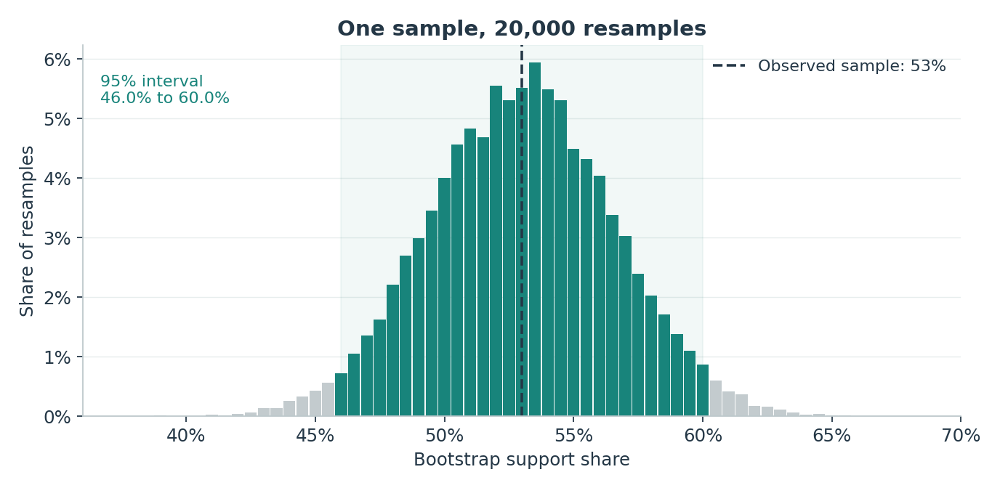
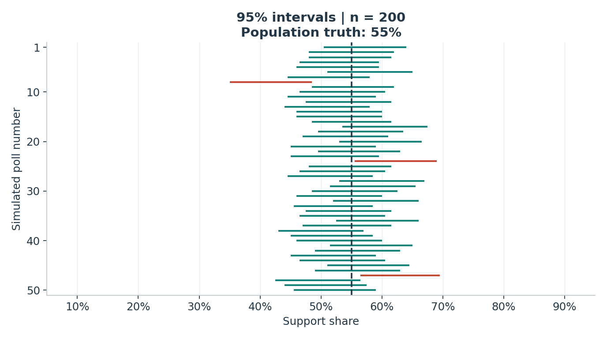
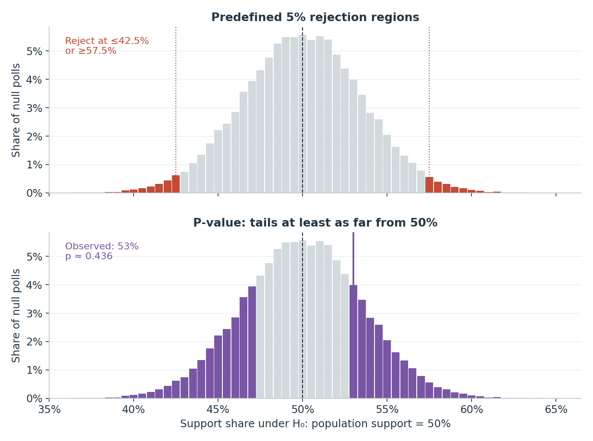

A survey reports **53% support for a transit proposal**. Is that convincing evidence that population support differs from an even split? The percentage alone cannot answer: a small sample can produce a small majority by chance. We need to know how much results vary across samples.

This is a **simulation, not an actual poll**. I set population support to 55% and generate independent yes/no responses. Knowing the truth lets us check an inference procedure in a way an actual survey cannot. The main example uses 200 responses; the interactive experiment also considers 50 and 800.

## One poll becomes a bootstrap distribution

The first 200 simulated responses contain 106 supporters, giving 53% support. Suppose we could see these responses but did not know population support. [Bootstrapping](https://online.stat.psu.edu/stat200/Lesson04) approximates sampling uncertainty by treating the observed sample as a stand-in for the population.

Draw 200 responses **with replacement** from that sample, calculate their support share, and repeat 20,000 times. Replacement allows a response to appear multiple times. The histogram shows the resulting bootstrap distribution, centered near the original estimate. Its 2.5th and 97.5th percentiles give a **95% percentile interval of 46.0%–60.0%**. The interval includes both 50% and the hidden 55% truth.

```{=html}
<figure>
<picture><source media="(max-width:540px)" srcset="results/bootstrap_mobile.png"></picture>
<figcaption>Figure 1. Resampling one observed poll. Green bars mark bootstrap shares inside the percentile interval; the dashed line marks the original estimate.</figcaption>
</figure>
```

The resamples reuse information; they do not create 20,000 new surveys. More bootstrap draws make the computed percentiles more stable, but collecting more respondents is what reduces the original sampling uncertainty.

## What the 95% promise means

To check coverage, I repeat the **whole survey**, not just its bootstrap. For each of 5,000 fresh polls, I construct a new percentile interval using 2,000 resamples of that poll. At 200 respondents, **4,783 intervals contain 55%: 95.7% coverage**. The other 217 miss it. Simulation noise alone contributes about 0.29 percentage points of standard error to this estimated coverage rate.

```{=html}
<style>
.blog8-print-coverage{display:none!important;}
.blog8-print-coverage img{width:100%;height:auto;}
@media print{
 .blog8-live-coverage{display:none!important;}
 .blog8-print-coverage{display:block!important;margin:1em 0;}
}
</style>
<div class="blog8-live-coverage">
<iframe id="blog8-coverage" src="results/coverage_explorer.html" title="Explore confidence interval coverage by sample size and confidence level" style="width:100%;height:790px;border:0;display:block;" loading="eager"></iframe>
</div>
<figure class="blog8-print-coverage">

</figure>
<script>
(function(){
 const frame=document.getElementById('blog8-coverage');
 window.addEventListener('message',function(event){
  if(event.source!==frame.contentWindow || !event.data || event.data.type!=='blog8-coverage-height')return;
  const height=Math.ceil(Number(event.data.height));
  if(Number.isFinite(height) && height>=200 && height<=4000 && Math.abs(frame.getBoundingClientRect().height-height)>.5){
   frame.style.height=height+'px';
  }
 });
 const measure=()=>frame.contentWindow.postMessage({type:'blog8-measure-height'},'*');
 frame.addEventListener('load',measure);
 measure();
})();
</script>
```

*Figure 2. Change the sample size or confidence level. The lines show the first 50 intervals; the totals use all 5,000.* [Open the experiment separately](results/coverage_explorer.html){target="_blank" rel="noopener"}.

This is the [repeated-sampling interpretation](https://www.itl.nist.gov/div898/handbook/prc/section1/prc14.htm): the method should cover the fixed truth about 95% of the time. After an interval is calculated, it either contains that truth or misses it; 95% describes the procedure's long-run performance.

Keep confidence at 95% and increase the sample size from 50 to 800. Average interval width falls from **27.5 to 6.9 percentage points**. Then hold sample size fixed and select 99%: intervals widen to cover more often. Nominal coverage is approximate, especially with discrete responses or small samples; this experiment does not guarantee that every bootstrap procedure achieves 95%.

## A p-value asks a different question

For testing, I impose **$H_0:p=0.50$** and use the sample support share as the test statistic. I generate 50,000 fresh 200-person polls under that null. Unlike the bootstrap distribution centered near 53%, this null distribution is centered near 50%. The two-sided alternative is $p\ne0.50$, so departures in either direction count.

```{=html}
<figure>
<picture><source media="(max-width:540px)" srcset="results/null_test_mobile.png"></picture>
<figcaption>Figure 3. The same null distribution answers two questions: which results trigger rejection, and how extreme is this particular result?</figcaption>
</figure>
```

The upper panel marks the **5% rejection regions**, chosen before assessing the observed result: support at or below 42.5%, or at or above 57.5%. Together these contain 4.0% of null simulations. Because counts are discrete, the cutoff cannot allocate exactly 5% to the tails.

The lower panel instead shades results **at least as far from 50% as the observed 53%**, including the opposite tail at 47% or below. There are 21,775 such null polls. With a one-count Monte Carlo correction, the p-value is $(1+21,775)/(1+50{,}000)\approx0.436$. An exact binomial calculation gives 0.437, a useful check.

That is the chance of a result this extreme or more extreme **assuming the null**, rather than the probability that the null is true. Since the p-value exceeds 0.05, we do not reject the even split. This does not establish that support equals 50%; the known simulation truth is actually 55%.

**The takeaway:** 53% alone is incomplete evidence. Bootstrap intervals describe uncertainty, coverage checks how often the procedure succeeds, and a p-value measures incompatibility with a specified null. All three rely on the sampling model; resampling cannot repair a biased survey.

## Code and replication

All observations are simulated, with a fixed seed. The [README](README.md), [Python script](code/build_blog8.py), [simulation design](data/simulation_design.json), [coverage results](results/coverage_summary.csv), and [test results](results/test_summary.csv) reproduce the figures and numbers. Background on [hypothesis tests and p-values](https://online.stat.psu.edu/stat200/Lesson05) is available from Penn State's statistics course.
